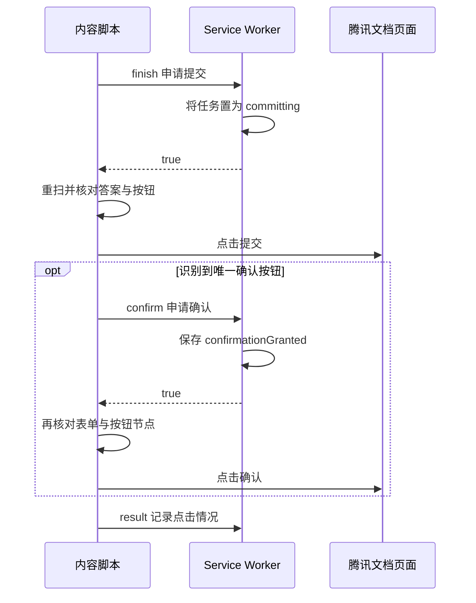

# 腾讯文档通用报名助手技术交接

本项目是原生 JavaScript 实现的 Manifest V3 浏览器扩展。`TencentForm_OneShot/` 是可直接加载的扩展目录。开发时修改源码并在浏览器重新加载扩展，再刷新表单标签页。当前项目使用 `manifest.json` 的 `version` 作为扩展和打包版本的来源。

## 源码分工

| 文件 | 职责 |
| --- | --- |
| [manifest.json](../TencentForm_OneShot/manifest.json) | 定义版本、`activeTab` 和 `storage` 权限、弹窗入口、后台 Service Worker 和内容脚本注入规则。 |
| [shared.js](../TencentForm_OneShot/shared.js) | 提取表单 ID，生成任务存储键，清理字符串，定义填写和提交确认的时间窗口。 |
| [popup.html](../TencentForm_OneShot/popup.html) 与 [popup.js](../TencentForm_OneShot/popup.js) | 显示识别出的题目，保存草稿，启动或取消任务，展示后台任务状态。 |
| [form.js](../TencentForm_OneShot/form.js) | 识别页面中的题目、选项和按钮，将答案转换为可校验的填写操作。 |
| [content.js](../TencentForm_OneShot/content.js) | 接收弹窗指令，读取当前标签页的任务，定时扫描、填写、校验并处理提交确认。 |
| [background.js](../TencentForm_OneShot/background.js) | 按标签页管理任务，串行处理消息和状态变更，批准首次提交及确认操作。 |

Manifest 在 `document_idle` 按 `shared.js`、`form.js`、`content.js` 的顺序注入脚本。页面路径需要符合 `https://docs.qq.com/form/page/<formId>`，可带尾斜杠和查询参数。`formId()` 使用路径中的 ID，查询参数不参与表单身份匹配。

### 执行环境

| 环境 | 能访问什么 | 生命周期对实现的影响 |
| --- | --- | --- |
| 弹窗 | 当前窗口的活动标签页、扩展自己的会话存储和弹窗 DOM | `tab` 在弹窗脚本初始化时查询一次。关闭弹窗会结束该实例，但已交给内容脚本的任务可以继续。 |
| 内容脚本 | 当前表单的 DOM，以及发给扩展后台的消息接口 | 与页面脚本共享 DOM，JavaScript 全局对象处于扩展的隔离环境。刷新页面会创建新的内容脚本实例，实例启动时重新向后台发送 `read`。 |
| Service Worker | 标签页信息、扩展消息和会话存储 | 可以被浏览器挂起。内存里的 `queue` 用于串行处理当前实例的消息，任务本身保存在会话存储。执行时钟由内容脚本负责。 |

`shared.js` 分别由 Manifest、弹窗的 `<script>` 和后台的 `importScripts()` 加载。各环境各有一份 `FormHelper`。增加公共方法时要检查三个加载入口。页面操作走 DOM 事件，由腾讯文档自己的页面逻辑执行实际填写和提交。

## 数据和消息

草稿和任务都使用 `chrome.storage.session`。草稿以表单 ID 分区，同一张表在同一浏览器会话内共用草稿。任务以标签页 ID 分区，并记录所属表单 ID 和一次性任务 ID。关闭标签页会清理其任务，表单草稿可供同一会话中的其他标签页继续使用。

| 存储键 | 值 |
| --- | --- |
| `draft:<formId>` | `[题目键, 答案]` 数组。文本、单选和原生下拉一般为字符串，多选为字符串数组。仅有标题的预览题可保存换行分隔的选择题答案。 |
| `task:<tabId>` | 待执行任务保存 `id`、`form`、`state`、`answers`、`submit`、`scheduled`、`at`、`until`、`reloaded`，以及可选的 `detail`。`at` 和 `until` 为毫秒时间戳。 |

以下为一个草稿值示例。启动任务时，弹窗会过滤空答案，将剩余的键值对转换成 `{ key, value }`。

```json
[
  ["姓名", "测试用户"],
  ["参加方式", "现场"],
  ["可用时间", ["上午", "下午"]]
]
```

### 题目对象和答案值

下面的类型用于说明接口形状，项目源码使用原生 JavaScript。

```ts
type Answer = string | string[];
type FieldKind = "text" | "textarea" | "radio" | "checkbox" | "select" | "preview" | "manual";

interface Field {
  key: string;
  title: string;
  kind: FieldKind;
  required: boolean;
  inputType: string;
  locked?: boolean;
  nodes: Element[];
  options: { element: Element; label: string }[];
}

type ScannedField = Omit<Field, "nodes" | "options"> & { options: string[] };
type TaskAnswer = { key: string; value: Answer };
```

- `nodes` 保存真实控件，预览题暂存标题节点。`options` 同时保存选项标签和要操作的 DOM 节点。`content.js` 回复 `scan` 时只传给弹窗字符串标签，弹窗不持有网页节点。
- `inputType` 仅在 `kind === "text"` 时有具体值。`locked` 只表示该题相关节点都被 `blocked()` 判定为不可用。单个选项禁用时，题目可以继续显示，其能否回填由 `resolve()` 判断。
- `popup.js` 的 `editors` 是题目键到取值函数的映射。单选控件用题目键作为 `name`，读取一个字符串。多选读取按弹窗选项顺序排列的标签数组。`manual` 不注册编辑器。
- `saveDraft()` 在编辑事件发生时读取整个弹窗的草稿快照，通过 `saveQueue` 串行写入。`refresh()` 先等待该实例已排队的保存，再扫描、重建编辑器并按题目键恢复值。队列只在本弹窗实例内有效，同一表单的多个弹窗实例没有草稿合并逻辑。
- `start()` 使用当前编辑器的快照，而不是重新读取存储。空字符串和空数组会被过滤。任务启动后的草稿编辑只影响下次启动，执行中的任务使用已保存的 `answers`。

恢复旧草稿时，单选和多选均接受数组或换行分隔字符串。弹窗用选项标签做精确恢复。执行阶段的 `resolve()` 还会做文本清理和 NFKC 归一化。如果改动选项格式，要分别检查弹窗是否恢复旧值，以及任务能否按旧值回填。

### 消息协议

弹窗到内容脚本使用 `chrome.tabs.sendMessage()`，弹窗和内容脚本到后台使用 `chrome.runtime.sendMessage()`。请求体均带 `type`。弹窗发给后台的请求带 `tabId`。内容脚本发出的任务更新带 `id`，后台从 `sender.tab.id` 取得标签页。

| 方向 | 类型 | 参数及返回 |
| --- | --- | --- |
| 弹窗 → 内容脚本 | `scan` | 无额外参数。返回 `{ form, title, fields }`，其中 `title` 取自 `document.title`。 |
| 弹窗 → 内容脚本 | `configure` | 无额外参数。重读任务并替换或停止监听。执行正常返回 `true`，抛出异常返回 `false`。没有待执行任务也可以正常返回 `true`。 |
| 弹窗 → 后台 | `arm` | `{ form, answers, submit, scheduled, at }`。成功返回任务摘要。若当前表单已有 `armed` 或 `committing` 任务，返回原任务摘要。参数校验失败返回 `null`。 |
| 弹窗 → 后台 | `status` | 返回 `{ state, at, until, detail }`，没有匹配任务时返回 `null`。 |
| 弹窗 → 后台 | `cancel` | 删除当前标签页的任务键后返回 `true`。弹窗随后发送 `configure`。 |
| 内容脚本 → 后台 | `read` | 无任务 ID 参数。返回当前表单的完整 `armed` 任务或 `null`。 |
| 内容脚本 → 后台 | `waiting` | `{ id, detail }`。仅在 `armed` 时接受，内容变化才写回。 |
| 内容脚本 → 后台 | `reload` | `{ id }`。只为尚未刷新过的定时任务批准一次。先写 `reloaded: true`，再返回 `true`。 |
| 内容脚本 → 后台 | `expire` | `{ id }`。处理 `armed` 任务过期。后台也可能在处理这条消息前完成过期转换，此时返回 `null`。 |
| 内容脚本 → 后台 | `finish` | `{ id, submit, detail }`。纯填写转为 `filled`，已获用户授权的提交转为 `committing`。返回 `true` 后页面才继续提交分支。 |
| 内容脚本 → 后台 | `confirm` | `{ id }`。仅对 `committing` 任务批准一次。后台写入 `confirmationGranted: true` 后返回 `true`。 |
| 内容脚本 → 后台 | `result` | `{ id, clicked, detail }`。仅对 `committing` 任务接受，根据 `clicked` 转为 `clicked` 或 `filled`。 |

后台从页面发送者的 `sender.url` 或 `chrome.tabs.get(tabId).url` 提取表单 ID。内容脚本的消息还必须来自顶层框架。`read` 之后的任务更新均需匹配 ID，并达到执行时间。常见的不适用请求返回 `null`，后台处理异常返回 `{ error: error.message }`。调用方需要按协议检查返回值，尤其是提交许可必须严格等于 `true`。

异步状态变更通过 `queue` 串行处理。进入 `committing` 后，会话存储只保留表单和任务 ID、状态与时间。结束态存储保留 `form`、`state`、`at`、`until`、`detail`。弹窗监听会话存储中当前任务键的变化，并在表单 ID 匹配时更新显示。

## 题目识别与回填

### 候选控件与标题

`FormReader.scan()` 优先从 `#fillBodyContent` 开始。若没有该 ID，则用组合选择器查询类名含 `fillBodyContent` 的元素、`#workbench-content-container` 下的表单或工作区容器。没有找到容器时返回空数组。`controlSelector` 会收集输入框、文本域、下拉框、可编辑元素，以及带 `radio`、`checkbox` 或 `combobox` 角色的节点。按钮类输入在扫描时被剔除。收集到候选节点只表示需要判断题型，实际可回填范围由后续的 `kind` 决定。

- `visible()` 要求节点有布局矩形，节点及祖先未设 `hidden` 或 `aria-hidden=true`，且计算出的 `visibility` 为 `visible`。隐藏的原生选项输入框可通过可见的关联标签或 ARIA 包装节点进入候选列表。ARIA 选项包装层内部若包含同类型原生输入，扫描时保留输入作为代表，避免同一选项出现两次。
- `blocked()` 检查节点的 `:disabled`、`readonly`、`aria-disabled=true`，以及节点或祖先的 `aria-disabled=true` 和 `inert`。扫描可以识别到暂不可操作的控件，`resolve()` 会在生成回填计划时检查可操作性。
- `titleElementIn(scope, anchor)` 在限定容器中寻找显式题名，例如 `legend`、`[data-question-title]` 或常见题名类。候选需可见、通过题名校验、没有嵌套控件，且不包住当前控件。只有一个候选时才采用。
- `previousHeading(anchor, scope, choice)` 沿祖先向外找前面的可见兄弟节点。遇到其他控件时停止扫描当前层的兄弟节点。同题型的单选项或复选项包装层可以跳过，以便多个选项追溯到同一个标题。遍历到已识别的题目卡片后不再向上扩展。
- 非选择题依次尝试 ARIA 名称、原生关联标签、卡片内显式题名、前方标题、占位文字。选择题优先使用推断分组的标题，然后依次尝试分组 ARIA 名称、容器内显式题名、相邻标题、预先记录的标题。单个复选项可用选项名称作为最后的题名来源。

`FormHelper.text()` 去掉部分零宽字符，折叠空白并修剪两端。`cleanTitle()` 进一步处理特定格式的序号、星号、冒号和提示文字。`isTitle()` 拒绝空值、超过 160 字符的文字、纯数字和形如「请输入」「请选择」「提交」「登录」的提示。`keyFor()` 对题名做 NFKC 归一化、去空白和小写转换。选项的 `optionKey()` 只做文本清理和 NFKC 归一化，保留大小写和归一后的词间空格。改这两个规则前需要考虑现有草稿键是否还能匹配。

### 单选、多选与同名选项

`choiceKind()` 优先读取 `role`，没有该属性时读取原生 `type`。类型只接受 `radio` 或 `checkbox`。分组过程使用 `used` 记录已经归入题目的节点，并按以下规则选出本题相关节点。

1. 单选在 `role=radiogroup` 内时，取最近的同一个 `radiogroup` 下尚未处理的单选控件。
2. 其他选择题优先匹配最近的 `fieldset`、ARIA 分组或已识别的卡片。候选须为同一题型、同一最近容器，且在起始控件有 `name` 时名称一致。没有容器时尝试按同一非空 `name` 归组，否则先视为独立控件。
3. 扫描前为非显式单选组的选择控件建立 `choiceHeadings`。复选项允许按同一个标题 DOM 节点重新归组，以适配每个选项各有 `name` 的情况。单选只在原分组仅有一个节点时尝试这个回退，并且候选的非空 `name` 不能重复。标题节点是引用，两个标题即使文字相同也仍是两个节点。
4. `choiceLabel()` 依次读取 ARIA 名称、原生关联标签、节点文本、外层标签和 ARIA 包装层。最后可读取只包住单个选项的父节点。可用选项必须有非空标签，且 `optionKey()` 在题内唯一。

`numberDuplicateCheckboxOptions()` 在唯一性校验之前给多选中的同名标签加序号。序号是该选项在整道题里的 DOM 顺序，从 1 开始。原顺序为「下午、上午、上午」时，弹窗收到「下午、上午（第 2 项）、上午（第 3 项）」。生成名称若与原标签或已生成标签冲突，会追加「（同名选项）」直至唯一。空标签仍会触发手动处理，单选的同名标签仍按歧义处理。

显示名、草稿值和回填匹配使用同一份生成后的标签。网页的原始选项文字保持原样，操作发生在对应 DOM 节点上。当前没有稳定的选项 ID，两个同名项换位时无法从标签发现换位。表单改动或选项乱序后，应重新识别并核对同名项的顺序。

### 预览、必填和手动处理

- `required` 来自原始题名中的星号、卡片的 `data-required=true` 或 `aria-required=true`、分组的 `aria-required=true`，以及控件的 `required` 或 `aria-required=true`。题名旁独立渲染的星号可能未被读取。识别必填时应确认页面实际用的是属性、题名文字还是独立 DOM。
- `preview` 来自尚未匹配到控件的显式标题。已识别题目卡片、关联输入的标签以及已存在题目键会被跳过。若 `#fillBodyContent` 中既没有候选控件也没有已识别题目，扫描还会尝试短小的星号开头文本节点。
- `manual` 用于无法归入支持题型、题名无效、选项有歧义或题目键重复的情况。重复键和空键的记录会在扫描结束时清空 `key` 和 `options`，保留题名供用户定位。自定义下拉、`<select multiple>`、文件上传和一般 `contenteditable` 需要专门适配。

### 回填计划和校验

`FormReader.resolve(field, answer)` 为当前这次扫描的节点生成 `{ matches, apply }`。暂不可填写的答案返回 `null`，由内容脚本等待后续扫描。

| 题型 | 计划如何匹配和执行 |
| --- | --- |
| `text`、`textarea` | 只接收字符串。`matches()` 比较网页 `value` 和原字符串。`setValue()` 调用对应原型的 `value` setter，再发送冒泡的 `input` 和 `change`。输入被浏览器清洗或被页面组件回写后，只有最终值相同才算填上。 |
| `select` | 仅支持原生单选下拉。扫描时排除空值和显式禁用的选项，计划通过标签定位目标，再写入目标 `<option>` 的真实 `value`。 |
| `radio` | 答案只能匹配一个选项。目标未选中时点击一次，之后用网页实际选中集合校验。原生输入读取 `checked`，ARIA 控件读取 `aria-checked="true"`。 |
| `checkbox` | 允许多个选项。先取消不在答案中的已选项，再勾选目标项，减少碰到最大勾选数的机会。只有最终选中集合和答案集合一致才完成。 |
| `manual`、`preview` | 返回 `null`。预览草稿需要等待页面出现受支持的真实控件才能执行。 |

选择题答案可以是数组或按行拆分的字符串。`resolve()` 清除空行，拒绝重复、缺失和被判定为不可用的目标选项。多选还拒绝必须改变状态却不可操作的非目标选项。比对前将标签归一化并排序，因此勾选顺序不影响完成判断。空草稿由弹窗过滤，含义是跳过该题。若目标选项一开始就被页面禁用，例如达到选项数上限后被禁用，当前实现会在生成计划时等待，只有可生成计划时才会尝试先取消旧选项。

## 执行与提交

| 状态 | 含义 |
| --- | --- |
| `armed` | 等待开始，或处于填写窗口中。 |
| `committing` | 已获得一次提交许可，正在校验、点击提交或等待确认框。 |
| `filled` | 纯填写已完成，或进入提交阶段后页面变化使首次点击未执行。 |
| `clicked` | 已点击网页的提交按钮，状态详情会说明是否同时点击确认。最终结果由腾讯文档页面反馈。 |
| `expired` | 填写窗口到期。 |
| `uncertain` | 提交阶段结束前后台未收到可记录的结果，例如页面跳转中断了消息。 |

### 从启动到填写

1. `popup.js` 的 `start(scheduled)` 过滤空答案。启用自动提交时，它还会拒绝含 `manual` 题目或识别出的必填题缺少草稿的任务。这一步检查的是弹窗草稿，即使用户已在原网页手填了必填题，也需要符合弹窗检查。
2. 立即填写用 `Date.now()`。定时填写将 `datetime-local` 按电脑本地时区转为时间戳，并要求未来时间。后台要求 `at` 为有限数值，允许因消息传输滞后最多 10 秒，未来时间最多提前 7 天。答案数组须含 1 至 300 项，表单与标签页须匹配。后台生成 `crypto.randomUUID()`，使用 `Math.max(Date.now(), at)` 作为开始时间，再加 `waitMs` 得到截止时间。当前 `waitMs` 为 20 秒。
3. 弹窗收到 `armed` 后发送 `configure`。如果收到明确的 `false` 或其他非 `true` 值，尝试撤销后台任务。如果消息本身抛出异常，当前代码进入通用失败分支。排查时可用 `status` 确认任务是否已写入后台。
4. `content.js` 的 `configure()` 给每次读取分配递增序号。较早的读取结果会被忽略，同一任务 ID 已配置时也不会重复挂载计时器。换任务或读到无任务时，调用旧的 `stop()` 清理计时器和观察器。
5. 到点后 `openingTimer` 在 `document.documentElement` 上启动 `MutationObserver`，关注子节点变化及 `class`、`style`、`hidden`、`disabled`、`readonly`、`aria-checked`、`aria-disabled`、`aria-invalid` 属性。150 毫秒轮询用于补充没有属性变化的控件状态更新。`endTimer` 到期停止本页任务，并尝试通知后台。

每轮 `check()` 先检查 `ended`、`busy`、截止时间和当前表单 ID。`inspect()` 每次重新扫描，用题目键为本次任务的每个答案生成计划。若首次检查时一个计划也没有，定时任务可以通过 `reload` 申请刷新一次，使用原来的截止时间继续。立即填写不会走这个分支。

写入前会调用 `plan.matches()`，已符合草稿的答案无需改动。`attempted` 是按题目首个 DOM 节点存储的 `WeakSet`，用于防止对同一节点持续点击。若页面重建了该节点，下一轮可以对新节点尝试。任一操作执行后，代码通过 `setTimeout(..., 0)` 给页面一次处理机会，再重新扫描，以新的 `matches()` 结果统计成功项。`busy` 防止一次填写尚在进行时由观察器或轮询重入。

没有全部填上时，任务继续等待，进度通过 `waiting` 回传，内容相同的进度会去重。如果控件保留同一个 DOM 节点但忽略了首次输入，下一轮仍会校验它，但当前策略通常不会再次对同一首节点调用 `apply()`。这是排查「能识别，始终填不进去」时需要检查的条件。

### 自动提交的两次许可



**第一次许可。** 纯填写只要求任务中准备的答案全部匹配。自动提交还要求 `ready(fields)` 成立，且找到唯一可用的提交按钮。`ready()` 检查所有扫描到的题目，要求无 `manual` 或 `preview`、已识别必填题有值、控件没有 `aria-invalid=true` 且原生 `validity.valid` 不为 `false`。`submitButton()` 优先在工作区内按可见性、禁用状态和明确的提交按钮文字定位。

后台处理 `finish` 时，纯填写直接存为 `filled`。自动提交先持久化 `committing`，再回复 `true`。这让其他来自同一任务的 `finish` 请求无法再次进入提交分支。截止时间取原期限与「当前时间加确认窗口再加 1 秒」中的较晚值。内容脚本收到许可后停止原填写截止计时器，再检查表单 ID、答案、校验状态和按钮。已有匹配的提交确认框会阻止首次点击。检查失败时发送 `result { clicked: false }`。

**第二次许可。** 首次点击后，内容脚本在 `confirmWaitMs` 定义的 3 秒内每约 100 毫秒查找确认框。`submitConfirmation()` 在文档内查找可见的「确认」按钮，再沿祖先寻找同时包含指定提示及可见「取消」按钮的容器。它返回 `{ present, button }`。存在匹配框但按钮禁用或候选不唯一时，`present` 为真，`button` 为空。

后台只批准同一个 `committing` 任务的一次 `confirm` 请求。返回后内容脚本还会核对截止时间、表单 ID 和候选按钮的 DOM 引用，确认它仍是同一个按钮。等待结束时，如果识别到了匹配的框但无法操作，详情提示在网页核对确认框。`clicked` 表示第一次提交按钮已被点击，详情区分是否还点了确认，页面是否接受答卷由腾讯文档反馈。

### 刷新、取消和过期

| 触发 | 当前实现 |
| --- | --- |
| 同一表单刷新，任务仍为 `armed` | 新内容脚本发 `read`，按原来的 `at` 和 `until` 恢复。新页面的 `attempted` 从空集合开始。 |
| 已进入 `committing` 后刷新 | 后台的 `read` 只返回 `armed`，因此新页面不会从提交阶段重放按钮点击。 |
| 取消任务 | 后台先删除任务，弹窗再发送 `configure` 使页面停止。若页面没收到重配置，原页面可能仍运行本地计时器直到过期，但新的提交或确认许可会因任务不存在而被拒绝。已触发的网页操作由腾讯文档处理。 |
| 关闭标签页 | 内容脚本随页面销毁，后台通过 `chrome.tabs.onRemoved` 删除任务键。草稿按表单保存，可供同一会话使用。 |
| 任务已过期 | 后台处理下一条匹配消息时检查 `until`，将 `armed` 转为 `expired`，将 `committing` 转为 `uncertain`。因此后台状态更新时间可能晚于页面计时器到期。 |
| 切换为另一张表 | 运行中的检查会核对表单 ID，后台也只返回属于当前表单的任务。新表单在同一标签页启动任务时可覆盖该标签页原来的任务槽。 |

任务队列只串行化后台存储操作。许可发出后，真正的点击发生在页面端，二者之间没有原子事务。取消主要阻止尚未取得许可的操作，并依赖页面收到重新配置来停止已经开始的工作。修改这段流程时，应保持「先存状态、再发许可、点击前复查」的顺序。

定时运行依赖原标签页和浏览器持续可用。浏览器后台节流、系统休眠、表单关闭或登录状态变化都可能延迟或阻止执行。当前实现没有后台唤醒调度器，填写以表单页面的计时器和 DOM 状态为准。

## 排查顺序

1. **弹窗无法读取表单。** 核对地址和 `manifest.json` 的匹配范围。重新加载扩展，刷新表单页。检查弹窗控制台、扩展 Service Worker 控制台和表单内容脚本的错误。
2. **题型或分组不对。** 在开发者工具中检查具体题目容器、标题节点、原生 `type`、`role`、`name`、`aria-checked` 与禁用状态。先对照 `scan()` 的结果，再调整选择器或分组规则。
3. **能选但填不进去。** 对照弹窗提交的草稿、`resolve()` 的匹配结果和点击后网页控件状态。多选尤其要检查同名选项、选项数限制、只读控件及页面是否重建了节点。
4. **填完没提交。** 检查自动提交选项、草稿完整性、`ready()` 和按钮匹配。如果首次点击成功但确认未发生，检查实际确认框的提示、按钮文字、可见性和出现时机。

当前必填识别读取题名中的星号、题目或分组的必填属性，以及控件的 `required` 属性。若新版网页把星号放在独立于题名的装饰节点，弹窗可能漏掉必填标记。类似地，仅由 CSS 类表达的只读状态可能需要单独适配。修改规则时，保留触发问题所需的最小 DOM 结构，并移除真实表单链接、答案和个人信息后再放进公开仓库。

### 控制台与断点

在测试表单标签页的开发者工具中，选择扩展内容脚本的执行上下文。若控制台提示 `FormReader` 未定义，检查当前上下文是不是网页主环境，并确认扩展重新加载后刷新过测试页。以下输出仅含题目元数据，可用来判断问题发生在识别还是回填。真实表单的题名也可能包含私密信息，分享输出前需脱敏。

```js
console.table(FormReader.scan().map(field => ({
  key: field.key,
  kind: field.kind,
  required: field.required,
  locked: field.locked,
  optionCount: field.options.length,
  controlCount: field.nodes.length,
})));
```

| 症状 | 从哪里开始断点 | 重点看什么 |
| --- | --- | --- |
| 同一道题被拆成多题 | `form.js` 的 `scan()` | `choiceKind`、`scope`、`choiceHeadings`、`related` 和最终的题目键计数。检查两个选项是否追溯到同一个标题节点。 |
| 题目被标为手动处理 | `form.js` 的 `optionLabels()` 和 `scan()` 末尾 | 是标签为空、单选项重名、控件类型不支持，还是不同题目生成了相同的键。 |
| 草稿可选但回填进度停住 | `content.js` 的 `inspect()` 和 `check()` | 对照 `task.answers`、当前题目键、`plan`、`matches()` 和 `attempted`。确认节点是否禁用、值是否被网页重写或节点是否被替换。 |
| 任务状态停在提交中 | `background.js` 的 `finish`、`confirm`、`result` 分支，以及 `content.js` 的 `submit()` | 对照任务 ID、表单 ID、消息时间和布尔返回值。查看是否已获得许可却在页面跳转前未回传结果。 |
| 确认按钮存在但未点击 | `form.js` 的 `submitConfirmation()` | 检查候选数量、提示语、同一容器是否含「取消」、按钮是否禁用，以及两次查找之间按钮节点是否换了引用。 |

### 后续改动入口

| 改动 | 涉及的契约 | 验证重点 |
| --- | --- | --- |
| 适配腾讯文档新的题目 DOM | `form.js` 的容器、标题、选项和状态提取 | 用最小脱敏 DOM 覆盖新旧结构，检查附近题目没有被错合并。 |
| 新增可填写题型 | `scan()` 产生的 `kind`，`popup.js` 的编辑器，`resolve()` 的执行计划，`ready()` 的完成校验 | 明确答案类型，确认能从弹窗保存、恢复、下发并读取真实回填值。 |
| 改变题目键或选项标识 | 草稿 `[key, value]`、任务 `{ key, value }` 和现有匹配规则 | 考虑同时读取旧格式与新格式。无法确定映射时提示重选，避免猜测同名项。 |
| 修改任务重试、超时或提交策略 | `shared.js` 的时间常量、内容脚本计时器、后台状态和回复 | 验证同标签页重复启动、刷新、取消、任务过期和提交许可只使用一次。 |

## 验证清单

从项目根目录运行 JavaScript 语法检查，需要本机已有 Node.js。

```powershell
foreach ($file in (Get-ChildItem -LiteralPath '.\TencentForm_OneShot' -File -Filter '*.js')) {
    node --check $file.FullName
    if ($LASTEXITCODE -ne 0) { throw "语法检查失败：$($file.Name)" }
}
```

浏览器验证使用可控制的测试表单。用临时 HTML 复现 DOM 时，可直接加载 `shared.js` 和 `form.js` 验证扫描及回填计划。验证完整的弹窗和任务流程时，在浏览器加载扩展并使用测试表单，或在本地浏览器测试页模拟 Chrome 消息与存储接口。

### 可运行的 DOM 回归示例

把下方内容临时保存为项目根目录的 `fixture.html`，用 Edge 或 Chrome 打开。它使用与真实页面相同的原生单选和 ARIA 复选语义，验证题型、同名编号、只选指定同名项及替换已选集合。页面显示 `PASS` 即为通过。示例直接加载识别和回填模块，用于定位 DOM 适配问题。完整任务流程仍按下面的场景验证。

```html
<!doctype html>
<meta charset="utf-8">
<title>报名助手 DOM 测试</title>
<main id="fillBodyContent">
  <fieldset>
    <legend>参加方式</legend>
    <label><input type="radio" name="mode">现场</label>
    <label><input type="radio" name="mode">远程</label>
  </fieldset>
  <section>
    <div class="question-title">可用时间</div>
    <div>
      <div role="checkbox" aria-checked="true">下午</div>
      <div role="checkbox" aria-checked="false">上午</div>
      <div role="checkbox" aria-checked="false">上午</div>
    </div>
  </section>
</main>
<output id="result">等待测试</output>
<script src="TencentForm_OneShot/shared.js"></script>
<script src="TencentForm_OneShot/form.js"></script>
<script>
  for (const option of document.querySelectorAll('[role="checkbox"]')) {
    option.addEventListener("click", () => {
      const checked = option.getAttribute("aria-checked") === "true";
      option.setAttribute("aria-checked", String(!checked));
    });
  }

  function expect(condition, message) {
    if (!condition) throw new Error(message);
  }

  const [mode, slots] = FormReader.scan();
  expect(mode?.kind === "radio", "参加方式应识别为单选");
  expect(slots?.kind === "checkbox", "可用时间应识别为多选");
  const labels = slots.options.map(option => option.label);
  expect(labels.join("|") === "下午|上午（第 2 项）|上午（第 3 项）", "同名项应按题内位置编号");

  const singlePlan = FormReader.resolve(mode, "远程");
  expect(singlePlan, "单选应生成计划");
  singlePlan.apply();
  expect(singlePlan.matches(), "单选应回填远程");

  const multiPlan = FormReader.resolve(slots, ["上午（第 3 项）"]);
  expect(multiPlan, "编号后的多选应生成计划");
  multiPlan.apply();
  expect(multiPlan.matches(), "多选应仅保留指定同名项");
  expect(slots.nodes.map(node => node.getAttribute("aria-checked")).join("|") === "false|false|true",
    "网页上的第三项应被选中");
  document.getElementById("result").textContent = "PASS";
</script>
```

### 完整流程回归

| 场景 | 检查项 |
| --- | --- |
| 同一页有文本、原生单选和 ARIA 多选 | 弹窗显示正确题型。单选互斥，多选可并存，各题独立回填。 |
| 多选项重名 | 弹窗按页面顺序编号。只勾第二项时网页只选第二项，两个都勾时网页都选中。 |
| 先前已选其他多选项 | 回填时先取消不需要的选择，最终网页选中集合与草稿一致。 |
| 草稿与重新识别 | 关闭后重新打开弹窗，原答案能恢复。表单或选项改变后检查旧草稿是否仍匹配。 |
| 定时、刷新和取消 | 到点前无写入，到点后才尝试填写。同表刷新后核对原截止时间，取消后检查后台任务和当前页监听都已清理。 |
| 仅填写和自动提交 | 默认只回填。在专用测试表单中验证直接提交、延迟确认框、已有确认框和不相关弹窗，核对点击次数与最终状态。 |
| 提交阶段页面变化 | 在获得首次许可或确认许可后替换按钮，核对代码重新检测页面并避免点击过期候选。刷新时确认新内容脚本不会重放提交。 |
| 手动题和同名题 | 保留手动处理提示，避免把答案填到含义不明确的题目。 |

## 打包与发布

从项目根目录运行 PowerShell。构建产物进入 `dist/`，ZIP 根目录直接包含 `manifest.json`，解压后可加载该目录。

```powershell
$manifest = Get-Content -LiteralPath '.\TencentForm_OneShot\manifest.json' -Raw -Encoding utf8 | ConvertFrom-Json
New-Item -ItemType Directory -Path '.\dist' -Force | Out-Null
Compress-Archive -Path '.\TencentForm_OneShot\*' `
    -DestinationPath ".\dist\TencentForm_OneShot-$($manifest.version).zip" -Force
```

发布前核对 ZIP 内的 `manifest.json` 版本和脚本与源码一致。当前扩展目录有 7 个文件。版本号按发布安排在 `manifest.json` 中显式修改。Git 仓库包含源码、`README.md`、`docs/` 和 `.gitignore`。`dist/` 与 `local/` 由 Git 忽略，若要发布 ZIP，可作为 GitHub Release 附件单独上传。
